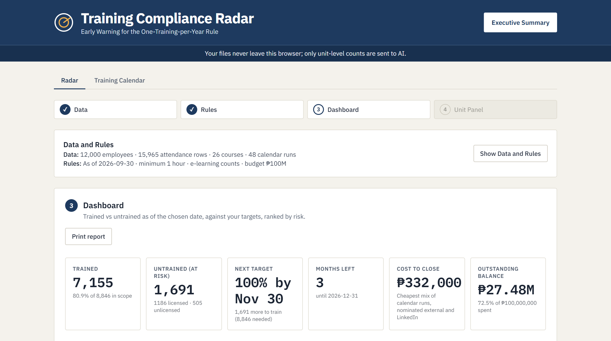
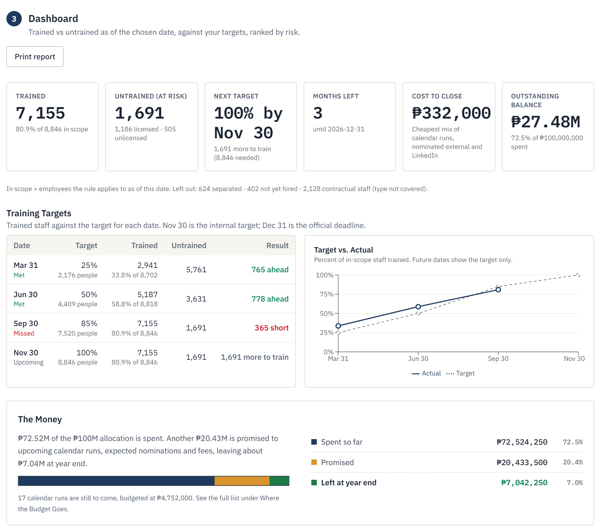
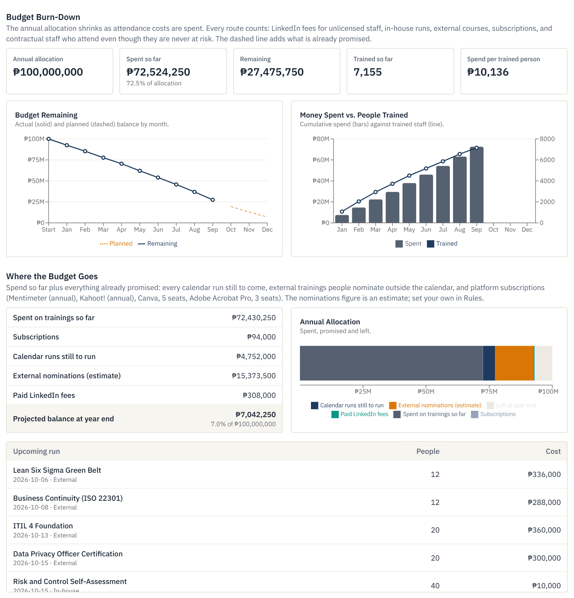
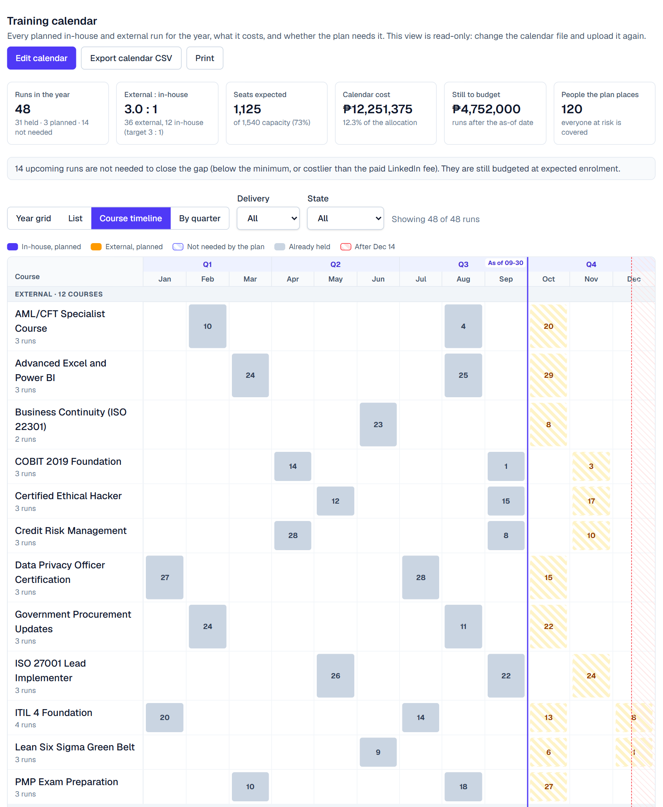
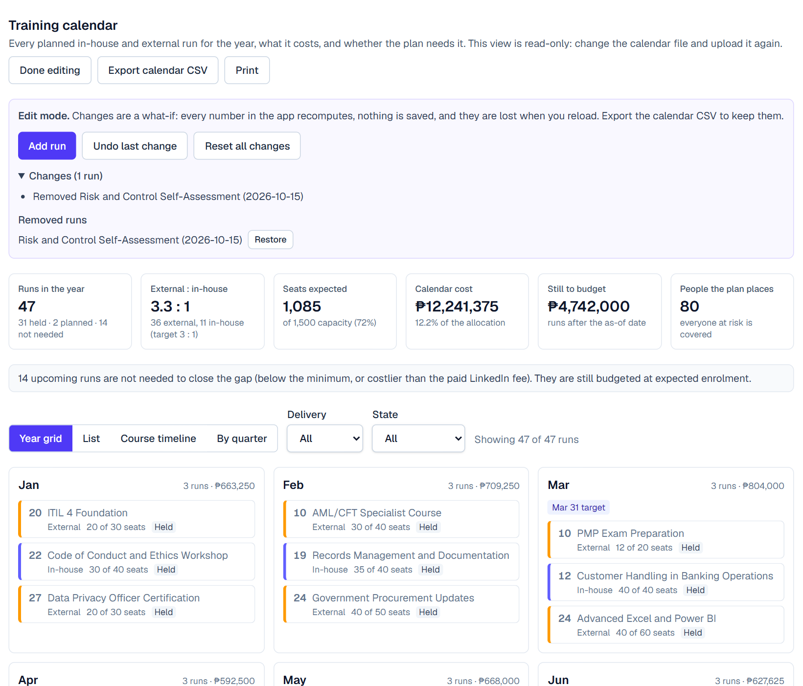
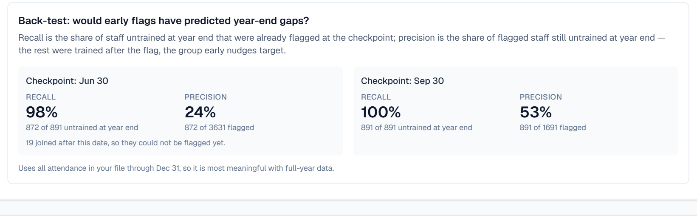
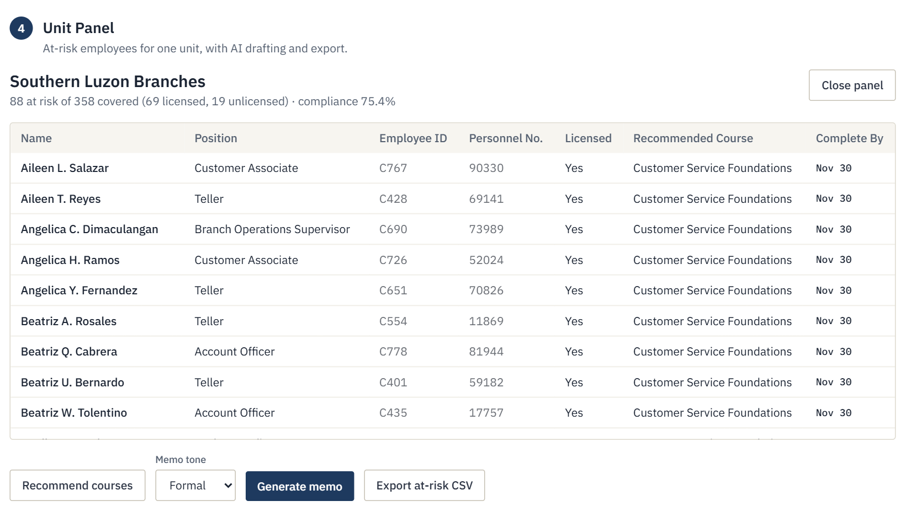
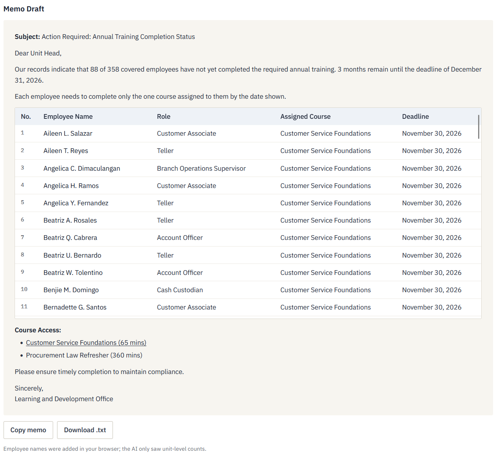
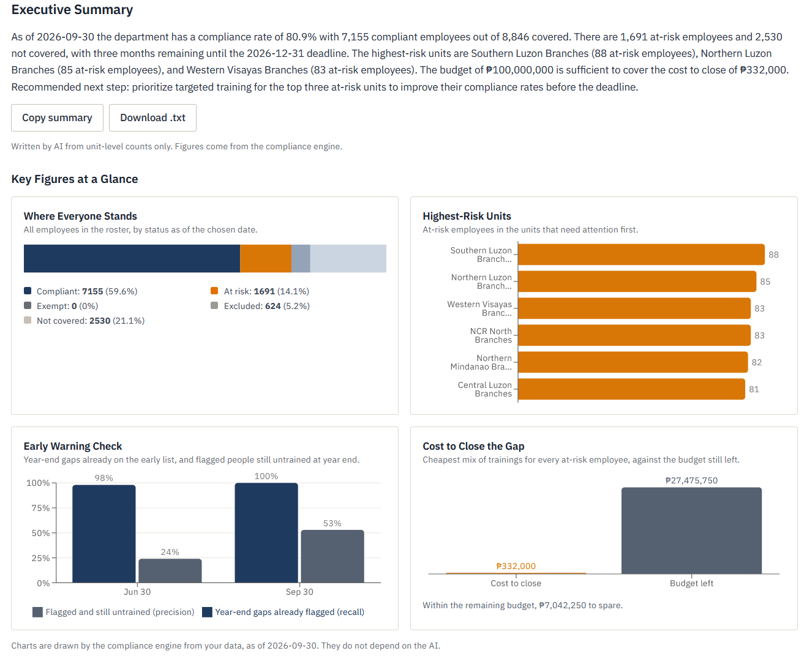

# Training Compliance Radar

[](https://github.com/Chris-GottaGit5hub/training-compliance-radar/actions/workflows/ci.yml)

Privacy-first AI app that flags employees at risk of missing the at least, one-training-per-year rule, months before year-end.

**Live demo:** https://training-compliance-radar.vercel.app — click **Load sample data** to try it with a synthetic agency. No sign-in, nothing to install. (AI features run on Groq's free plan, with Gemini as backup; if every model is busy or out of quota, the app shows a labeled template built from the same numbers and everything else still works.)

**2-minute demo video:** https://drive.google.com/file/d/1gecp01gxgB5zJGGtD134m79k7OZMQYfj/view?usp=sharing (narrated walkthrough of the live site: dashboard, budget, training calendar, Early Warning Check, AI recommendations, memo and executive summary).

## The problem

Philippine government agencies expect every employee to complete at least one planned learning and development (L&D) intervention a year. L&D teams usually find out who missed it in Q4, when it is too late to fix, and then send "explain why" memos. The covered population changes monthly (hires, separations, transfers) and records sit in several sources, so spreadsheets struggle.

Training Compliance Radar answers one question early: **who is still untrained, in which unit, and what is the cheapest way to close the gap?**

## Screenshots

All screens use the built-in synthetic sample (12,000 fictional employees). More in [`docs/screenshots/`](docs/screenshots/).

**Overview: once data is loaded, Data and Rules fold into one bar and the dashboard comes up**


**Dashboard: trained vs untrained, Training Targets and The Money**


**Budget Burn-Down and Where the Budget Goes**


**Training Calendar: Course Timeline**


**What-if: one run removed, every number recalculated**


**Early Warning Check: would the warnings have been right?**


**Unit Panel: at-risk staff for one department (names stay in the browser)**


**AI memo: one course and a deadline per person (names merged in the browser; the AI saw only unit counts)**


**AI Executive Summary with four engine-drawn charts**


## Features

- **Upload and validate** roster, attendance and (optional) course catalog and training calendar CSVs in the browser, with row-numbered errors; or load the built-in sample: 12,000 synthetic employees in 50 departments under 7 sectors, with Employee IDs A100 to N399 and unique 5-digit Personnel Numbers. Field list: [`docs/data-dictionary.md`](docs/data-dictionary.md).
- **Data and Rules fold away** once everything is loaded and valid, into a one-line summary with a Show/Hide toggle, so the dashboard is what you see; they reopen on any error.
- **Churn-aware compliance engine** (deterministic TypeScript): late-hire exemptions, exclusion of separated staff, covered employment types, minimum hours, and an e-learning toggle, as of any date.
- **Who is covered:** only regular staff can be at risk. Contractual staff may attend (their costs count as spend) but are never at risk. A footnote says who is left out of scope and why.
- **Risk dashboard**: trained vs untrained, the next target, months left, cost to close, a bar chart and a ranked table of units that still have untrained staff.
- **Training targets**: 25/50/85/100% of in-scope staff trained by Mar 31, Jun 30, Sep 30 and Nov 30 (editable), shown as met, missed or upcoming with the people still needed.
- **Slicers**: trained vs untrained by pay-grade band (Rank and File, Officers, Senior Officers), pay grade, department, group and sector, alone or combined (optional roster columns `pay_grade`, `group`, `sector`).
- **The Money**: one panel that says, in a sentence, a bar and a three-line table, how much of the allocation is spent, how much is already promised, and what is projected to be left at year end.
- **Budget Burn-Down**: the annual allocation against money spent by month, people trained, and spend per trained person, with charts and a Print report button.
- **Realistic balance**: spend so far plus everything already promised, namely every calendar run still to come (in-house runs priced from speaker honoraria and snacks, external trainings at their fee per participant, external : in-house 3:1), expected external nominations outside the calendar, and annual subscriptions (Mentimeter, Kahoot!, Canva, Adobe), giving a projected year-end balance. Subscriptions and nominations are editable in Rules.
- **Training calendar tab**, with an **Edit calendar** what-if mode (add, edit, duplicate and remove runs; undo, restore and reset; every number recomputes; changes stay in the browser and are lost on reload, so export the CSV to keep them): every planned run for the year in four views (month grid, list, a course-by-month timeline, and a by-quarter list of trainings still available with estimated seats open), each run with its state (held, planned, not needed, after Dec 14), cost at expected enrolment, seats, the external : in-house mix against 3:1, cost by month, the sector windows for the recommended course, alerts, CSV export and print.
- **Recommended-course windows and a plan** (optional catalog flag `recommended` and `calendar.csv`): one staggered monthly window per sector for the annual course (e.g. AMLA), who completed or missed it, and a deterministic plan for the rest: licensed staff on LinkedIn at no extra cost, unlicensed staff in calendar runs above their minimum size or on the paid LinkedIn fee, no in-person runs after Dec 14.
- **Early Warning Check** (the back-test, in plain words): for Jun 30 and Sep 30, how many people were flagged, how many caught up on their own, how many were still untrained on Dec 31, and whether anyone was missed; recall and precision in small print.
- **Unit panel**: at-risk employees, each with a **Recommended Course** and a **Complete By** date (licensed staff on a LinkedIn course by Nov 30, unlicensed staff in the calendar run the plan places them in, by its date), CSV export with the same columns, an AI-drafted memo laid out as justified paragraphs, a numbered table of each person's assigned course and deadline, and a Course Access list (copy and download keep the same order), and catalog-grounded course recommendations.
- **Works without AI, too:** if an AI call fails or the free quota runs out, memos and the executive summary fall back to a clearly labeled template draft built from the same numbers.
- **Executive summary** for a department head: an AI-written narrative plus four charts (status breakdown, highest-risk units, early warning check, cost vs budget) drawn from the engine, so they stay accurate and still appear if the AI is unavailable.
- **Privacy by design**: employee names and IDs never leave the browser.
- **Civic Ledger look**: a navy header, warm paper background, ruled panels, IBM Plex type with monospaced figures, and Title Case headings, chosen from five design options.

## How it works

> **Code computes, AI communicates.** Compliance status is decided only by tested code in `lib/engine`. The AI never decides who is compliant and never produces the numbers you see; it drafts memos, picks courses from your catalog, and writes summaries.

Architecture diagram and layer choices: [`docs/architecture.md`](docs/architecture.md#system-diagram). Full requirements: [`spec.md`](spec.md) (source of truth) and [`docs/prd.md`](docs/prd.md).

## Setup

Requires Node.js (current LTS) and npm.

```bash
npm install
cp .env.example .env.local   # then add your key (see below)
npm run dev                  # http://localhost:3000
```

The dashboard works without any key. AI buttons need one.

| Command | What it does |
|---|---|
| `npm run dev` | Start the dev server |
| `npm run build` / `npm start` | Production build and server |
| `npm run lint` | ESLint |
| `npm run typecheck` | `tsc --noEmit` |
| `npm test` | Vitest |
| `npm run sample-data` | Regenerate the seeded synthetic CSVs in `public/sample/` |

### Environment variables

| Variable | Values | Default | Notes |
|---|---|---|---|
| `AI_PROVIDER` | `google` \| `anthropic` \| `groq` | `google` | Selects the primary provider for all AI routes |
| `AI_MODEL` | model ID | `gemini-3.8-flash` (google) / `claude-haiku-5-5` (anthropic) / `openai/gpt-oss-120b` (groq) | Optional override |
| `AI_THINKING_LEVEL` | `minimal` | `low` | `medium` | `high` | `low` | Gemini only: lower is faster. Raise it only if answers are poor |
| `AI_FALLBACK_MODEL` | comma-separated `model` or `provider:model` entries, or `none` | `gemini-3.6-flash` (google); `google:gemini-3.6-flash,google:gemini-3.8-flash` (groq) | Backups tried in order (max 3) on 429/5xx, timeout, 404 (retired model) or invalid output; a bad request or key also moves on when the next backup is another provider. Entries without a key for their provider are skipped |
| `GOOGLE_GENERATIVE_AI_API_KEY` | secret | — | Required when `AI_PROVIDER=google` or for a `google:` backup |
| `ANTHROPIC_API_KEY` | secret | — | Required only when `AI_PROVIDER=anthropic` or for an `anthropic:` backup |
| `GROQ_API_KEY` | secret | — | Required when `AI_PROVIDER=groq` or for a `groq:` backup |

Switching provider is one variable (`AI_PROVIDER=groq` or `anthropic`) plus its key. Backups can be on another provider (`provider:model`), so the recommended free setup is Groq first with Gemini 3.6 then 3.8 behind it (set `AI_PROVIDER=groq` and both keys). With no key, the AI routes return `503` and the UI shows template drafts and picks while everything else keeps working. `GET /api/status` shows the primary and backups by name only. Never commit `.env.local`; on Vercel, set these in the project's Environment Variables.

## Tests

`npm test` runs **406 tests in 37 files** (Vitest). They cover:

- every compliance rule and their order, ranking, rounding, back-test and cost-to-close;
- CSV validation (missing columns, duplicates, impossible dates, limits);
- aggregates-only payload builders (no names or IDs, small-cell suppression);
- catalog-ID filtering, memo token enforcement, numeric grounding, provider resolution;
- the 10-requests-per-minute rate limiter and every API guard (400, 413, 429, 502, 503);
- the sample data (15–25% at risk as of Sep 30) and the at-risk CSV export (formula-injection guard).

CI runs lint, typecheck, tests, build, a report-only `npm audit`, and gitleaks on every push.

## Back-test results (Early Warning Check)

On the seeded synthetic data (12,000 employees, year 2026), the app goes back to each checkpoint, takes everyone untrained then, and compares them with who was actually untrained at Dec 31. The dashboard shows this as the **Early Warning Check** card in plain words:

| Checkpoint | Flagged | Caught up on their own | Still untrained at year end | Missed | Recall | Precision |
|---|---|---|---|---|---|---|
| Jun 30 | 3,631 | 2,759 (76%) | 872 (24%) | 19 (all joined after Jun 30) | 98% | 24% |
| Sep 30 | 1,691 | 800 (47%) | 891 (53%) | none | 100% | 53% |

- **Recall** (share of year-end gaps already flagged) meets the PRD target of at least 80%. It is structurally high: an untrained employee stays at risk until trained, so recall mainly drops for people hired after the checkpoint.
- **Precision** is the informative number. `1 − precision` is the share of flagged staff who were trained before year-end: the group early nudges target (76% at Jun 30, 47% at Sep 30).
- These results come from synthetic data, so they show the method works, not how an agency would perform. See [`spec.md` §4.1](spec.md).

## Privacy and data handling

- CSV files are parsed **in your browser**. There is no database and no server-side storage.
- API routes receive **unit-level aggregates only**: unit names, counts, deadlines, common positions (only positions held by 3 or more at-risk employees), and catalog course fields. Request schemas reject any extra field, so a name or ID cannot pass validation.
- Memos contain a `{{EMPLOYEE_LIST}}` token; names are merged into the memo locally.
- Server logs hold one line per AI call (route, provider, model, latency, status), never payloads.
- Only synthetic data is in this repository.

> **Free-tier Gemini note:** On the Gemini API free tier, Google may use prompts and responses to improve its products. That is acceptable here because only aggregates and synthetic data are sent. Use a paid tier, or review your organization's data privacy policy, before using real data.

## Limitations

- **Free-tier AI quotas.** Production uses Groq's free plan first (`openai/gpt-oss-120b`: 30 requests a minute, about 1,000 a day, 8,000 tokens a minute), then Gemini's free tier (about **20 requests per day per model**) as backups. Each AI button click uses 1–2 requests. If every model is busy or out of quota, the app shows a clear message with a Retry button and falls back to a **template memo or summary** built from the engine's numbers, and **template course picks** from the catalog (all labeled as such). The dashboard, charts and CSV export never use AI.
- Data must be re-uploaded each session (by design; nothing is stored).
- The rate limiter is in memory, so on serverless each instance counts separately (best effort).
- AI output can be imperfect: numbers are checked against the request and flagged with a warning if they do not match, but memos should be read before sending.
- Rules default to common practice (e.g. late-hire cutoff Oct 1). Confirm what counts as a qualifying training with your policy owner.
- The course catalog is a CSV you maintain; there is no live LinkedIn Learning connection yet.
- Back-test results use synthetic data.

## Roadmap

v2 ideas (persistence, auth, LinkedIn Learning API sync, explanation-reply analyzer, slot matchmaker) are tracked in [issue #1: v2 — persistence, auth, LinkedIn Learning API sync, explanation-reply analyzer, slot matchmaker](https://github.com/Chris-GottaGit5hub/training-compliance-radar/issues/1). Out-of-scope items for v1 are listed in [`docs/prd.md`](docs/prd.md#4-out-of-scope-v1).

## Submission checklist

> **[CHRIS: verify this table against the official assignment brief]** It was assembled from the requirements recorded in the repo's own docs; rename or add rows if the brief words things differently.

| Requirement | Where it is met |
|---|---|
| Validated idea (problem, user, market, competition, edge, test, risks) | [`docs/validation.md`](docs/validation.md) |
| Product requirements and success metrics | [`docs/prd.md`](docs/prd.md) |
| Architecture and stack rationale | [`docs/architecture.md`](docs/architecture.md) |
| Spec as source of truth, with revision log (v1.0 to v1.3) | [`spec.md`](spec.md) |
| AI agent rules and project conventions | [`AGENTS.md`](AGENTS.md), [`CLAUDE.md`](CLAUDE.md), [`.cursorrules`](.cursorrules) |
| Working app on the recommended stack (Next.js, TypeScript, Tailwind, Vercel AI SDK) | `app/`, `components/`, `lib/` |
| Deployed and publicly reachable | https://training-compliance-radar.vercel.app |
| Core logic is deterministic and tested | `lib/engine/`, `tests/` (368 tests) |
| AI features with structured output and grounding | `app/api/*`, `lib/ai/`, `lib/payload/` |
| Data privacy handled (aggregates only, local name merge) | [Privacy](#privacy-and-data-handling), `lib/payload/`, `tests/payload.test.ts` |
| Security basics (validation, size limits, rate limit, no secrets in git) | `lib/api/`, `.env.example`, gitleaks in CI |
| CI/CD | [`.github/workflows/ci.yml`](.github/workflows/ci.yml) plus Vercel Git deploys |
| Monitoring | Vercel Web Analytics and Speed Insights in `app/layout.tsx`; per-call AI logs |
| Synthetic data only | `scripts/generate-sample-data.ts`, `public/sample/` |
| Build process documented | [`docs/build-plan.md`](docs/build-plan.md) |
| Reflection | [`docs/reflection.md`](docs/reflection.md) (draft) |
| Demo | [2-minute video](https://drive.google.com/file/d/1gecp01gxgB5zJGGtD134m79k7OZMQYfj/view?usp=sharing) · script: [`docs/demo-script.md`](docs/demo-script.md) |
| Next steps | [v2 GitHub issue #1](https://github.com/Chris-GottaGit5hub/training-compliance-radar/issues/1); [Roadmap](#roadmap) |

## License

MIT. See [`LICENSE`](LICENSE).
