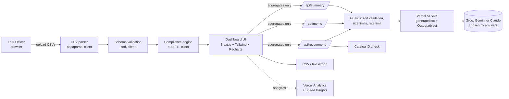

# Architecture Notes — Training Compliance Radar

## Principles
1. **Code computes, AI communicates.** Compliance status is decided only by deterministic, unit-tested TypeScript. The LLM never decides who is compliant; it only drafts memos, recommends catalog courses, and writes summaries.
2. **Privacy by design.** CSV files are parsed **in the browser**. API routes receive **unit-level aggregates only** — no employee names or IDs ever leave the browser. Names are merged into memos locally.
3. **No database, no accounts (v1).** Nothing is stored server-side. This removes the need for auth and keeps employee data off third-party storage. Persistence and login are v2 items.
4. **Grounded AI output.** Recommendations must come from the uploaded course catalog; the server validates every returned course ID.

## System diagram

## Layers (Week 4B reference stack)
| Layer | Choice | Why |
|---|---|---|
| Frontend | Next.js (App Router) + TypeScript (strict) + Tailwind CSS | Recommended stack; first-class Vercel support |
| Charts | Recharts | Simple React charts |
| CSV | papaparse (client-side) | Keeps raw employee data in the browser |
| Validation | zod (client + server) | One schema source for CSV rows and API payloads |
| LLM layer | Vercel AI SDK (`ai`, `@ai-sdk/google` default — `gemini-3.8-flash`; `@ai-sdk/groq` — `openai/gpt-oss-120b`; `@ai-sdk/anthropic` — `claude-haiku-5-5`) | Structured output via `generateText + Output.object` + zod; provider swap by one env var (`AI_PROVIDER`); ordered backup chain across providers (`AI_FALLBACK_MODEL`) |
| Orchestration | Next.js Route Handlers (`/api/*`), serverless on Vercel | No always-on server needed |
| Data / retrieval | Curated course catalog CSV (no vector DB) | Small, controlled list; grounding by ID validation |
| Database / Auth | **None in v1 (deliberate)** | Privacy-first; nothing to store or protect |
| Testing | Vitest | Fast unit tests for engine, validation, payload builders |
| CI/CD | GitHub Actions (lint, typecheck, test, build, gitleaks) + Vercel Git deploys | Required by brief |
| Monitoring | Vercel Web Analytics + Speed Insights; structured server logs for AI calls (latency, status) | Required by brief; zero cost |

## Data flow for one memo
1. Engine computes Unit X: 12 at-risk of 85 covered; 3 months left.
2. Client sends `{ unit, atRiskCount, coveredCount, deadline, monthsRemaining, courses[] }` to `/api/memo` — **no names**.
3. Server validates, rate-limits, calls the LLM with a zod output schema → `{ subject, body }` where body contains `{{EMPLOYEE_LIST}}`.
4. Client replaces `{{EMPLOYEE_LIST}}` with the 12 names locally; user copies or exports.

## Environment variables
| Variable | Values | Default | Notes |
|---|---|---|---|
| `AI_PROVIDER` | `google` \| `anthropic` \| `groq` | `google` | Selects the primary provider for all AI routes |
| `AI_MODEL` | model ID | `gemini-3.8-flash` (google) / `claude-haiku-5-5` (anthropic) / `openai/gpt-oss-120b` (groq) | Optional override |
| `AI_THINKING_LEVEL` | `minimal` | `low` | `medium` | `high` | `low` | Gemini only: lower is faster. Raise it only if answers are poor |
| `AI_FALLBACK_MODEL` | comma-separated `model` or `provider:model` entries, or `none` | `gemini-3.6-flash` (google); `google:gemini-3.6-flash,google:gemini-3.8-flash` (groq) | Backups tried in order (max 3) on 429/5xx, timeout, 404 (retired model) or invalid output; a bad request or key also moves on when the next backup is another provider. Entries without a key for their provider are skipped |
| `GOOGLE_GENERATIVE_AI_API_KEY` | secret | — | Required when `AI_PROVIDER=google` or for a `google:` backup |
| `ANTHROPIC_API_KEY` | secret | — | Required only when `AI_PROVIDER=anthropic` or for an `anthropic:` backup |
| `GROQ_API_KEY` | secret | — | Required when `AI_PROVIDER=groq` or for a `groq:` backup |

Backups run in order and may be on another provider (`provider:model`); unknown primary provider or missing primary key → AI routes return 503 and the engine/dashboard keep working.

## Security
- API key only in env vars (`.env.local` locally; Vercel project settings in prod); never in client code (`NEXT_PUBLIC_` prefix forbidden for secrets).
- Server-side zod validation + payload size limits on every route; `maxDuration` raised for AI routes.
- Best-effort in-memory rate limit per IP (documented limitation on serverless; v2: Upstash/Vercel KV).
- gitleaks in CI; `npm audit` reported in CI.
- Synthetic data only in the public repo.

## Trade-offs accepted
| Choice | Benefit | Cost |
|---|---|---|
| No DB / no auth | Privacy, speed of build | Data must be re-uploaded each session |
| Client-side parsing | Raw data never leaves the browser | Large files limited by browser memory (cap: 20,000 rows) |
| Catalog CSV, no LinkedIn API | Buildable today, no approval needed | Catalog maintained manually |
| In-memory rate limit | No extra service | Not shared across serverless instances |
| Gemini free tier as default | ₱0 AI cost | Google may use free-tier prompts to improve its products; acceptable because only aggregates and synthetic data are sent |
